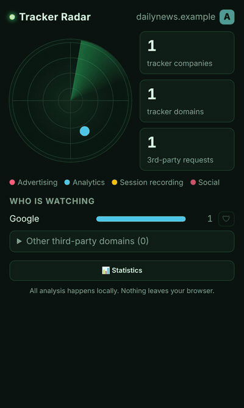

# 📡 Tracker Radar

**See, live, which companies the website you're on is sending your data to.**

Tracker Radar is a lightweight browser extension that watches every third-party request a page makes and shows you, on a radar, who is collecting data about you: ad networks, analytics, session recorders and social widgets.



## Features

- 🛰️ **Live radar.** Every tracking company is a blip. Colour shows what it does, distance from the center shows the category.
- 🔢 **Badge counter** on the toolbar icon with the number of tracking companies on the current page (green → orange → red).
- 🏢 **Grouped by company.** Google, Meta, Microsoft, Criteo, Hotjar… with a click-to-expand list of their domains.
- 🛡️ **One-click blocking.** Hit the shield next to any company to block its trackers on every website (uses the browser's built-in `declarativeNetRequest`, so it's fast and private).
- 🅰️ **Privacy grade A–F** for every page, based on how many trackers it loads and what they do (session recorders hurt the most).
- 📊 **History & statistics.** See how many companies followed you in the last 7 or 30 days, who follows you the most and which websites are the worst. Stored locally, auto-deleted after 30 days.
- 📚 **290+ known tracker domains** from 160+ companies, including European and Polish ad tech.
- 🎥 **Session recorder detection.** Know when a site records your mouse movements and clicks (Hotjar, Clarity, FullStory, Smartlook…).
- 🌍 **Speaks your language.** English, Polish, German, Spanish, French and Ukrainian, picked automatically from your browser settings.
- 🔒 **100% local.** No servers, no analytics, no data leaves your browser. Ironic otherwise, right?

## Install

> 🦊 Firefox Add-ons and Chrome Web Store listings are on the way. Until then, grab the zip from [Releases](https://github.com/Vapson12/tracker-radar/releases).

### Firefox (128+)

1. Download `tracker-radar-firefox.zip` from [Releases](https://github.com/Vapson12/tracker-radar/releases) (or run `python3 build.py`).
2. Open `about:debugging#/runtime/this-firefox`.
3. Click **Load Temporary Add-on…** and select `dist/tracker-radar-firefox.zip`.
4. Open the popup and click **Grant access** if Firefox asks for site access.

Temporary add-ons are removed when Firefox restarts. For a permanent install, sign the extension on [addons.mozilla.org](https://addons.mozilla.org/developers/) (an unlisted listing is free and signed automatically).

### Chrome / Edge / Brave / Opera

1. Download `tracker-radar-chrome.zip` from [Releases](https://github.com/Vapson12/tracker-radar/releases) and unzip it (or run `python3 build.py`).
2. Open `chrome://extensions` (also works in Edge, Brave, Opera).
3. Turn on **Developer mode** (top right).
4. Click **Load unpacked** and select the unzipped folder.
5. Pin the 📡 icon and open any website.

> Tip: if the extension was installed while tabs were already open, reload the page to start scanning.

## How it works

- `background.js` listens to `webRequest.onBeforeRequest` to observe requests. Blocking is done separately with `declarativeNetRequest` dynamic rules (one rule per blocked company, third-party requests only).
- Each request's host is compared with the page's own domain. Anything else is **third-party**.
- Third-party hosts are matched against `trackers.js`, a curated list of tracker domains mapped to their **company** and **category**.
- Per-tab results are kept in `storage.session` and cleared when the tab closes. Daily history and the block list live in `storage.local`.
- `scoring.js` turns the trackers on a page into a score and an A–F grade.

## Contributing

The easiest way to help is to **add trackers** to `trackers.js`:

```js
'example-tracker.com': ['Company Name', 'ads'], // ads | analytics | recording | social
```

Ideas for the roadmap:

- [x] Firefox support
- [x] Blocking mode (declarativeNetRequest)
- [x] History: "this week you were tracked by 143 companies"
- [x] Privacy grade per website
- [ ] Per-site allowlist (pause blocking on a site)
- [ ] Export statistics (CSV/JSON)
- [ ] Even bigger tracker database (community contributions welcome!)
- [x] Translations (add yours in `_locales/<lang>/messages.json`)

## License

MIT
